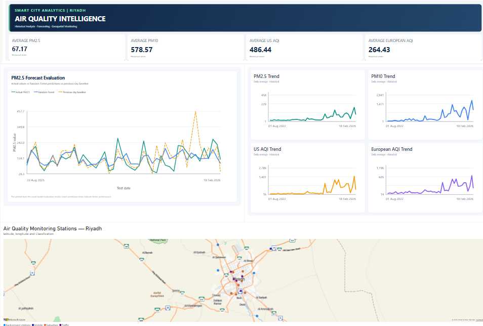
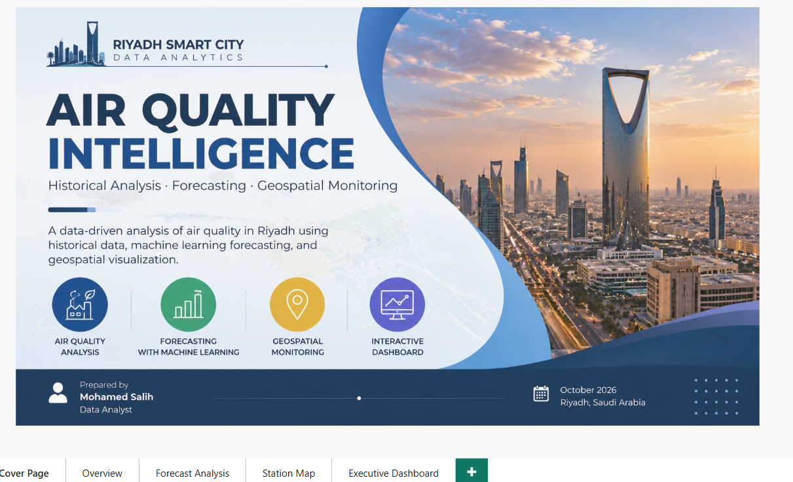

# Riyadh Smart City Analytics — Air Quality Intelligence

An end-to-end data analytics project focused on historical air quality analysis, PM2.5 forecasting, and geospatial visualization of air quality monitoring stations in Riyadh, Saudi Arabia.

## Project Overview

This project combines data analysis, time-series forecasting, geospatial analytics, and Power BI dashboard development to explore air quality indicators and monitoring station locations in Riyadh.

The project includes:
- Historical air quality data quality assessment and cleaning.
- Exploratory data analysis and monthly trend visualization.
- PM2.5 forecasting using a Random Forest regression model.
- Model evaluation against a previous-day baseline.
- Geospatial processing and visualization of official monitoring station locations.
- An interactive Power BI report for data exploration and model evaluation.

## Project Objectives

- Examine historical patterns in PM2.5, PM10, and air quality indices.
- Identify missing observations and investigate potential outliers.
- Develop and evaluate a baseline forecasting model for PM2.5.
- Analyze the geographic distribution and classifications of monitoring stations.
- Communicate analytical findings through visualizations and an interactive dashboard.

## Tools and Technologies

- **Python:** Data processing and analysis
- **Pandas and NumPy:** Data manipulation
- **Matplotlib:** Data visualization
- **GeoPandas:** Geospatial data processing
- **Folium:** Interactive station mapping
- **Scikit-learn:** Machine learning and model evaluation
- **Power BI:** Interactive dashboards and reporting
- **Git and GitHub:** Version control and project documentation


## Project Structure

```text
riyadh-smart-city-analytics/
├── dashboards/
│   ├── cover_page.png
│   ├── executive_dashboard.png
│   └── riyadh_smart_city_dashboard.pbix
├── data/
│   ├── raw/
│   │   ├── air-quality-stations-in-riyadh-2025.csv
│   │   ├── air_quality_historical.csv
│   │   ├── city_info.csv
│   │   ├── data_dictionary.csv
│   │   └── dataset-metadata.json
│   └── processed/
│       ├── riyadh_air_stations_clean.csv
│       ├── riyadh_air_stations_geospatial.csv
│       └── riyadh_air_stations.geojson
├── reports/
│   ├── data_completeness.csv
│   ├── monthly_air_quality.csv
│   ├── monthly_pm2_5.png
│   ├── monthly_pm10.png
│   ├── monthly_us_aqi.png
│   ├── monthly_european_aqi.png
│   ├── pm25_forecast_metrics.csv
│   ├── pm25_forecast_test_results.csv
│   ├── pm25_actual_vs_predicted.png
│   ├── pm25_prediction_error_distribution.png
│   └── riyadh_air_quality_stations_map.html
├── src/
│   ├── create_station_map.py
│   ├── forecast_air_quality.py
│   ├── geospatial_analysis.py
│   ├── inspect_data.py
│   ├── plot_forecast_results.py
│   ├── prepare_stations.py
│   ├── quality_check.py
│   ├── station_spatial_summary.py
│   └── time_series_analysis.py
├── requirements.txt
└── README.md
```


## Data Sources and Scope

The project uses two distinct datasets:

### 1. Historical Air Quality Data

The historical dataset contains 1,298 daily observations from August 1, 2022, to February 18, 2026, with pollutant measurements and air quality indicators.

Key variables include:
- PM2.5 and PM10
- Carbon monoxide
- Nitrogen dioxide
- Sulphur dioxide
- Ozone
- US AQI and European AQI
- Other environmental indicators

### 2. Riyadh Monitoring Station Locations

The station dataset contains 17 monitoring station locations and their classifications, including traffic, suburban, background, and mobile stations.

**Important data limitation:** The historical air quality dataset does not contain station identifiers or geographic coordinates. Therefore, the historical pollutant readings are analyzed separately from the official station locations. The project does not claim that the historical readings were measured by these specific stations.

## Methodology

### Data Quality Assessment

The historical dataset was inspected for:
- Missing values
- Duplicate dates
- Calendar date gaps
- Potential statistical outliers
- Descriptive statistics and correlations

The dataset contains a small number of missing pollutant and AQI values. Potential outliers were flagged for investigation rather than automatically assumed to be errors.

### Exploratory Data Analysis

The analysis includes:
- Monthly air quality summaries
- PM2.5 and PM10 trends
- US AQI and European AQI trends
- Correlation analysis between selected indicators
- Visual inspection of extreme observations

### Geospatial Analysis

GeoPandas was used to process monitoring station coordinates and prepare geospatial outputs.

The analysis includes:
- Station classification summaries
- Geographic visualization of station locations
- Spatial distribution summaries
- Distance calculations from the centroid of the station distribution

The calculated distances describe proximity to the station-distribution centroid, not distance from an official Riyadh city center.

### PM2.5 Forecasting

A Random Forest regression model was developed using historical PM2.5 values, lagged observations, rolling averages, and date-based features.

The data was split chronologically, with the final 180 observations used for testing. Model performance was compared with a baseline that predicts PM2.5 using the previous day's observation.

## Forecasting Results

| Metric | Random Forest | Previous-Day Baseline |
|---|---:|---:|
| MAE | 47.545 | 50.809 |
| RMSE | 61.706 | 70.988 |

The Random Forest model improved MAE by approximately 6.4% and RMSE by approximately 13.1% compared with the previous-day baseline on the evaluated test period.

These results represent an initial forecasting experiment. They do not establish that the model will perform equally well on future observations or on individual monitoring stations.


## Power BI Dashboard

### Executive Dashboard


### Project Cover


The Power BI report includes five pages:

- **Cover Page:** Project introduction.
- **Executive Dashboard:** Consolidated project overview.
- **Overview:** Historical air quality trends and indicators.
- **Forecast Analysis:** PM2.5 model evaluation.
- **Station Map:** Geographic distribution of monitoring stations.

## Key Outputs

The `reports/` directory contains generated analytical outputs, including:
- Data completeness summaries
- Potential outlier reports
- Missing-date checks
- Monthly air quality summaries
- Station classification summaries
- Geospatial station maps
- Station distance calculations
- Forecast test results and evaluation metrics
- Forecast comparison and error-distribution plots

## Limitations

- Historical pollutant readings are not linked to individual monitoring stations.
- Statistical outliers require domain-specific investigation before being classified as erroneous.
- The forecasting model is an initial experiment and requires further validation and comparison with additional models.
- Forecast performance is evaluated on a chronological holdout period and is not a guarantee of future accuracy.
- The station map represents station locations, not pollutant concentrations measured at each location.

## Future Improvements

- Compare Random Forest with seasonal-naive, statistical, and additional machine learning forecasting methods.
- Apply rolling-origin time-series cross-validation.
- Investigate extreme observations using domain knowledge and source documentation.
- Add uncertainty intervals to forecasts.
- Improve dashboard documentation and analytical interpretation.
- Establish a validated connection between station-level measurements and geographic locations if suitable data becomes available.

## Author

**Mohamed Salih**  
Data Analyst | Python | Power BI | Machine Learning | Geospatial Analytics

---

This project was developed as a data analytics portfolio project to demonstrate data preparation, exploratory analysis, forecasting, geospatial processing, and dashboard development.
